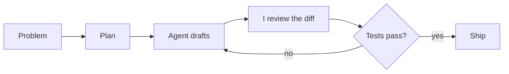

<div align="center">

# Jemish Kevadiya

### I turn messy input into shipped software.

Full-stack developer · Toronto · React, TypeScript, Node.js, Python

[LinkedIn](https://linkedin.com/in/jemish2327) · [Email](mailto:jemish2327@gmail.com) · [GitNarrate](https://gitnarrate.com)

</div>

---

```text
jemish@toronto ~ % cat now.txt

shipping   GitNarrate: AI release notes from your commits (gitnarrate.com)
building   HR and event-booking features at Octfis Techno
studying   how AI coding agents fail, for AfterQuery
reading    other people's diffs, carefully

jemish@toronto ~ % git log --career
```

## CHANGELOG.md

*My career, written the way my own product would write it.*

### [Unreleased]
- **GitNarrate public frontend** is in active development. The backend is already live and the waitlist is open.

### v3.0.0 · 2026
**Software Engineer (Contract), AfterQuery Experts**
- Added: JavaScript tasks, reference solutions, and automated tests that measure whether AI-generated changes actually work
- Fixed: defects traced through unfamiliar codebases to the root cause
- Learned: where AI agents succeed, where they confidently fail, and how to review them

### v2.5.0 · 2026
**GitNarrate** (co-built, two-person team)
- Added: Claude API pipeline that turns commit history into structured release notes
- Added: schema validation and recovery for when the model returns something malformed
- Added: BullMQ + Redis jobs triggered by Git tag webhooks
- Added: GitHub and GitLab OAuth, Stripe subscription billing

### v2.0.0 · 2025
**Full Stack Developer, Octfis Techno**
- Added: 10+ REST APIs and HR features (employee records, leave approvals, attendance) with role-based access
- Improved: API response times **-20%**, HR dashboard load times **-25%**, event booking responses **-30%**
- Changed: stopped guessing at slowness and started tracing it to the query or the re-render causing it

### v1.0.0 · 2022
**Advanced Diploma, Computer Programming and Analysis, George Brown College**
- Initial release.

## How I build with AI

I use Claude Code, Cursor, and Codex daily. The agent drafts and I decide what ships.



## Known issues

- Cannot leave a slow query alone once I've noticed it
- Reads the whole diff, even the lockfile
- Will say "quick question" and mean a two-hour debugging session

<details>
<summary><b>Tech stack</b></summary>

<br>

| | |
|---|---|
| **Languages** | TypeScript, JavaScript, Python, Java, SQL |
| **Front end** | React, React Native, Angular |
| **Back end** | Node.js, Express, Spring Boot, REST APIs |
| **Data** | PostgreSQL, MySQL, MongoDB, Redis, BullMQ, Prisma |
| **Cloud** | AWS (ECS, RDS, S3), Docker, CI/CD |
| **AI** | Claude API, OpenAI API, Claude Code, Cursor, Codex |

</details>

---

<div align="center">

**Open to full-stack roles where I can ship product with design and product teams.**

[LinkedIn](https://linkedin.com/in/jemish2327) · [Email](mailto:jemish2327@gmail.com)

</div>
